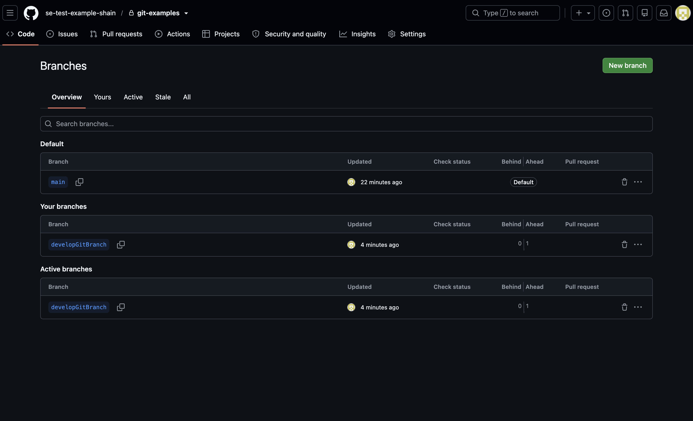
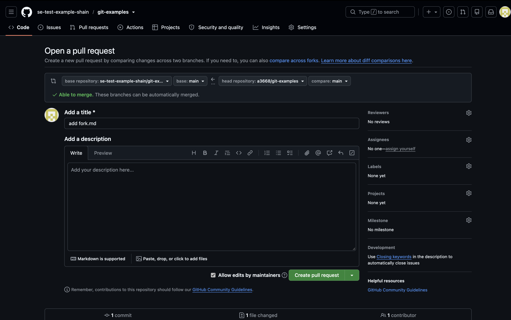
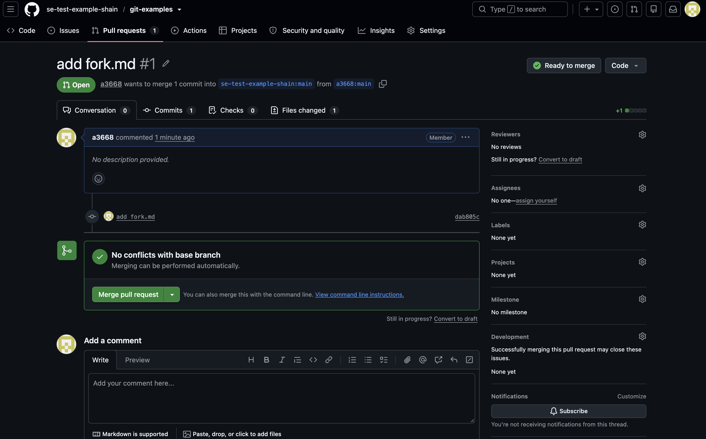
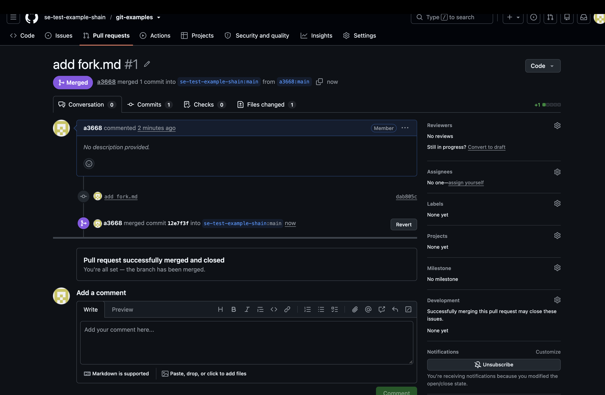

# git-examples

- 母專案：https://github.com/se-test-example-shain/git-examples
- 分支：https://github.com/se-test-example-shain/git-examples/tree/developGitBranch
- 子專案（fork）：https://github.com/a3668/git-examples

---

## 流程總覽

```text
【母專案 se-test-example-shain/git-examples】
  git clone ──► git checkout -b developGitBranch ──► 修改 README.md
     ──► git add / git commit ──► git push origin developGitBranch   (1. 分支)
     ──► git checkout main ──► git merge developGitBranch
     ──► git push origin main                                         (2. 合併)

【子專案 a3668/git-examples】
  GitHub 按 Fork                                                      (3. Fork)
     ──► git clone ──► 新增 fork.md ──► git add / git commit ──► git push
     ──► GitHub 按 Open pull request                                  (4. Pull Request)

【回到母專案】
  GitHub 按 Merge pull request ──► 本機 git pull 取回 fork.md
```

---

## 對應的 Git 流程

| 步驟                      | 對應流程                                       | 說明                                                                                                                                          |
| ------------------------- | ---------------------------------------------- | --------------------------------------------------------------------------------------------------------------------------------------------- |
| 1. 分支 + 2. 合併         | 功能分支（feature branch）                     | 從 `main` 拉出 `developGitBranch`，在分支上開發，完成後合併回 `main`。這次是在本機直接 `git merge`，沒有經過 PR                               |
| 3. Fork + 4. Pull Request | Github flow 的 Pull Request + Forking workflow | Github flow 是「開分支 → 發 PR → 評審 → 合併進主分支」。這次的 PR 是從自己 fork 的專案發到母專案，這種做法叫 Forking workflow，開源專案很常用 |

常見的三種 Git 流程：

- **Git flow**：有 `master`（穩定版）和 `develop`（日常開發）兩個長期分支，再搭配 feature、release、hotfix 三種短期分支。
- **Github flow**：只有一個長期分支 `master`，新功能從 `master` 開分支，透過 Pull Request 評審後合併回 `master`。
- **Gitlab flow**：結合上面兩者，原則是「上游優先」（upstream first），`master` 是所有分支的上游。

三種流程都以功能分支為基礎：先開分支開發，完成後再合併回主分支。Forking workflow 是在 Github flow 的基礎上，讓沒有母專案寫入權限的人也能透過自己的 fork 發 PR 貢獻程式碼。

### Git 的四個區域

```text
 Working directory ──git add──► Staging area ──git commit──► Local repository ──git push──► Remote repository
（編輯檔案的地方）          （下一次 commit 的暫存區）     （本機的版本紀錄）            （GitHub 上的專案）
        ▲                                                       │  ▲                           │
        └──────────────────── git checkout / git merge ─────────┘  └──── git pull（fetch + merge）┘
```

下方指令速查表的「資料移動」欄位，會標出每個指令把資料從哪個區域搬到哪個區域。

---

## 1. 建立分支（Branch）

> 對應：功能分支（feature branch）

### 1-1 把母專案複製到本機

```bash
git clone https://github.com/se-test-example-shain/git-examples.git
cd git-examples
```

確認遠端版本庫設定：

```bash
git remote -v
# origin  git@github.com:se-test-example-shain/git-examples.git (fetch)
# origin  git@github.com:se-test-example-shain/git-examples.git (push)
```

確認目前所在的分支：

```bash
git branch --show-current
# main
```

### 1-2 建立新分支並切換過去

```bash
git checkout -b developGitBranch
# Switched to a new branch 'developGitBranch'
```

`-b` 代表「建立新分支」，等同於先 `git branch developGitBranch` 再 `git checkout developGitBranch`。

列出所有本機分支（`*` 表示目前所在分支）：

```bash
git branch
# * developGitBranch
#   main
```

### 1-3 在分支上修改並提交

修改 `README.md` 後：

```bash
git add README.md                  # 把檔案加入暫存區（Staging Area）
git commit -m "修改README.md"      # 把暫存區的變更存成一筆版本快照
# [developGitBranch 0652859] 修改README.md
#  1 file changed, 20 insertions(+), 1 deletion(-)
```

### 1-4 把分支推送到 GitHub

```bash
git push origin developGitBranch
# To github.com:se-test-example-shain/git-examples.git
#  * [new branch]      developGitBranch -> developGitBranch
```

推送後，GitHub 上就出現了 `developGitBranch` 分支（2 Branches，且顯示 _1 commit ahead of main_）：




---

## 2. 合併（Merge）

> 對應：功能分支完成後合併回主分支

### 2-1 切回 main

```bash
git checkout main
# Switched to branch 'main'
# Your branch is up to date with 'origin/main'.
```

### 2-2 合併前先比較兩個分支的差異

```bash
git diff --name-only main..developGitBranch
# README.md
```

有列出檔案，表示兩個分支內容不同。

### 2-3 把 developGitBranch 合併進 main

```bash
git merge developGitBranch
# Updating 2f762ad..0652859
# Fast-forward
#  README.md | 21 ++++++++++++++++++++-
#  1 file changed, 20 insertions(+), 1 deletion(-)
```

> **Fast-forward** 是 `git merge` 的一種合併方式：建立分支之後 `main` 沒有任何新的 commit，所以 Git 直接把 `main` 的指標往前移到 `developGitBranch` 的最新 commit（0652859），不會產生額外的 merge commit。

### 2-4 確認已合併

```bash
git diff --name-only main..developGitBranch
# （輸出為空）
```

輸出為空，代表兩個分支已經一致，合併完成。

### 2-5 把合併後的 main 推送到 GitHub

```bash
git push origin main
# To github.com:se-test-example-shain/git-examples.git
#    2f762ad..0652859  main -> main
```

---

## 3. Fork

> 對應：Forking workflow

Fork 是在 **GitHub 網頁上** 完成的，不是 git 指令。

### 3-1 在 GitHub 上 Fork

1. 登入 GitHub，打開母專案 https://github.com/se-test-example-shain/git-examples
2. 點右上角的 **Fork** 按鈕
3. Owner 選 `a3668`，按 **Create fork**
4. 產生子專案 https://github.com/a3668/git-examples ，頁面標題下方會顯示 _forked from se-test-example-shain/git-examples_

### 3-2 把 fork 下來的子專案 clone 到本機

```bash
git clone git@github.com:a3668/git-examples.git
# Cloning into 'git-examples'...
# Receiving objects: 100% (8/8), done.
```

### 3-3 在子專案新增檔案並推送

新增 `fork.md` 後：

```bash
git add fork.md
git commit -m "add fork.md"
# [main dab805c] add fork.md
#  1 file changed, 1 insertion(+)
#  create mode 100644 fork.md

git push
# To github.com:a3668/git-examples.git
#    0652859..dab805c  main -> main
```

這時子專案比母專案多了一個 commit（_This branch is 1 commit ahead of se-test-example-shain/git-examples:main_）：


---

## 4. Pull Request

> 對應：Github flow 的 Pull Request 流程

Pull Request 也是在 **GitHub 網頁上** 完成的。

### 4-1 從子專案開 PR

1. 在子專案頁面 https://github.com/a3668/git-examples 點 **Contribute** → **Open pull request**
2. 確認方向：
   - base repository：`se-test-example-shain/git-examples`，base：`main`（要被合併進去的地方）
   - head repository：`a3668/git-examples`，compare：`main`（我的修改）
3. 填寫標題與說明，按 **Create pull request**，產生 PR #1



### 4-2 在母專案合併 PR

1. 到母專案的 **Pull requests** 分頁，打開 PR #1
2. 按 **Merge pull request** → **Confirm merge**
3. GitHub 會在母專案產生一筆 merge commit：`12e7f3f Merge pull request #1 from a3668/main`





### 4-3 母專案本機把遠端的更新抓下來

回到母專案的本機資料夾：

```bash
git pull
# Updating 0652859..12e7f3f
# Fast-forward
#  fork.md | 1 +
#  1 file changed, 1 insertion(+)
#  create mode 100644 fork.md
```

現在母專案本機也有子專案貢獻的 `fork.md` 了。

---

## 最終的 commit 歷史

```text
12e7f3f Merge pull request #1 from a3668/main   ← 4. 在 GitHub 合併 PR
dab805c add fork.md                             ← 3. 在 fork 中提交
0652859 修改README.md                           ← 1. 在分支上提交 / 2. fast-forward 合併進 main
2f762ad Initial commit
```

---

## 指令速查表

| 指令 / 動作                   | 用途                             | 資料移動（四區域）                                       |
| ----------------------------- | -------------------------------- | -------------------------------------------------------- |
| `git clone <url>`             | 把遠端專案複製到本機             | Remote repository → Local repository + Working directory |
| `git remote -v`               | 列出已設定的遠端版本庫           | 查詢，不移動資料                                         |
| `git branch --show-current`   | 顯示目前所在分支                 | 查詢，不移動資料                                         |
| `git checkout -b <分支>`      | 建立新分支並切換過去             | 在 Local repository 建立分支                             |
| `git branch`                  | 列出本機所有分支                 | 查詢，不移動資料                                         |
| `git add <檔案>`              | 把檔案加入暫存區                 | Working directory → Staging area                         |
| `git commit -m "<訊息>"`      | 把暫存區的變更存成一筆 commit    | Staging area → Local repository                          |
| `git push origin <分支>`      | 把本機分支推送到遠端             | Local repository → Remote repository                     |
| `git checkout <分支>`         | 切換分支                         | Local repository → Working directory                     |
| `git diff --name-only A..B`   | 列出兩個分支間有差異的檔案       | 查詢，不移動資料                                         |
| `git merge <分支>`            | 把指定分支合併進目前分支         | Local repository 內合併，並更新 Working directory        |
| `git pull`                    | 從遠端抓取並合併最新變更         | Remote repository → Local repository + Working directory |
| GitHub **Fork** 按鈕          | 把別人的專案複製一份到自己帳號下 | Remote repository → 另一個 Remote repository             |
| GitHub **Open pull request**  | 請求母專案合併自己的修改         | 在 Remote repository 上操作                              |
| GitHub **Merge pull request** | 母專案擁有者接受並合併 PR        | 在 Remote repository 上合併                              |
